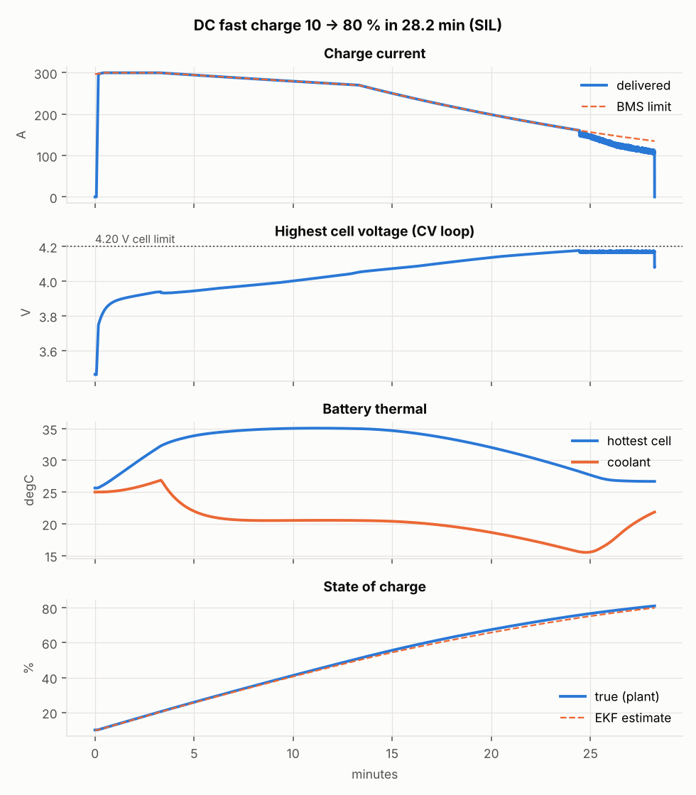
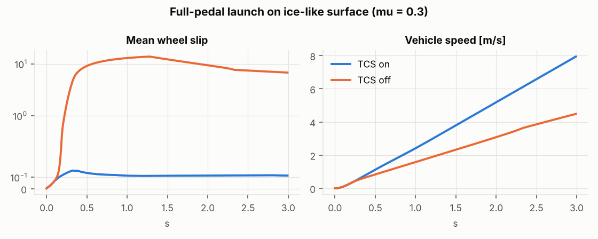
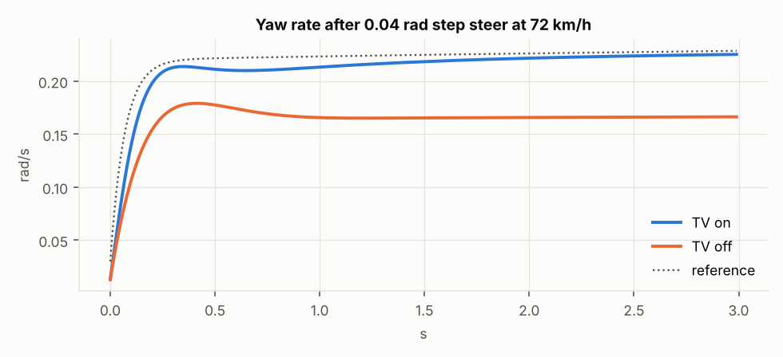

# zonecore — vehicle controls stack for a quad-motor EV

Embedded C99 control software for a software-defined electric vehicle, covering
**battery management, DC fast charging, thermal, propulsion, vehicle dynamics,
body/lighting, mechanisms and functional safety**. It's verified by a
closed-loop **Python software-in-the-loop (SIL)** bench that talks to the C code
over DBC-encoded, E2E-protected CAN frames.



| | |
|---|---|
| **C (production code)** | ~3.1 k lines · C99 · no heap · `-Werror -pedantic` + 10 extra warnings · clang-tidy (bugprone/CERT/analyzer) clean |
| **Unit tests** | 47 tests / 255 checks, dependency-free harness |
| **SIL tests** | 32 closed-loop scenarios incl. 9 fault-injection cases, ~20 s |
| **Requirements** | 46 ASIL-tagged requirements, **46/46 traced to tests** (`docs/traceability.md`) |
| **CAN** | hand-written DBC → generated C codec + Python codec, bit-identical |

## What's inside

| Domain | Highlights | Code |
|---|---|---|
| Energy storage | 2-state **EKF SOC** (OCV + 1RC), current-dependent measurement noise; 2-D **state-of-power** tables; passive **balancing**; two-tier OV/UV/OT protection; **contactor + precharge** SM with weld detection | `src/bms` |
| Charging | **DC fast-charge session** (cable check → precharge V-match → CC/CV → controlled stop), abort on E2E timeout / E-stop / unplug | `src/charge` |
| Thermal | cool/heat arbitration with hysteresis, DCFC-specific setpoints & **preconditioning**, PID with back-calculation **anti-windup** | `src/thermal` |
| Propulsion | dual-track **APPS plausibility**, **brake-throttle override**, one-pedal regen map, battery-power torque envelope, jerk limiting | `src/propulsion` |
| Vehicle dynamics | speed estimation robust to all-wheel spin, per-wheel **traction control**, single-track **yaw reference**, **torque vectoring** | `src/dynamics` |
| Body & lighting | indicators/hazard/comfort flash, **R13-H regen stop-lamp** logic, **emergency stop signal**, auto headlamps, auto-lock, crash unlock | `src/body` |
| Mechanisms | **anti-pinch power window** (current-based force estimate, reversal) | `src/body` |
| Functional safety | **L2 torque monitor**, **alive supervision**, latching safe-state manager, **UDS DTCs** w/ freeze frame, HARA + safety concept | `src/safety`, `docs/safety` |
| Platform / COM | rate-monotonic **cyclic executive** with WCET/overrun tracking; **E2E** (CRC-8/SAE-J1850 + alive counter + Data ID) | `src/platform`, `src/com` |

## Results (from the SIL bench)

| Scenario | Result |
|---|---|
| DC fast charge 10 → 80 % from 25 °C | **~28 min**, max cell 4.18 V (< 4.20), max cell temp ~36 °C, SOC estimate within 3 % throughout |
| Full-pedal launch, µ = 0.3 | mean slip **0.12** with TCS vs **> 10** without; ~1.8× the speed after 3 s |
| Step steer at 72 km/h | RMS yaw-rate error **−82 %** with torque vectoring |
| SOC estimator, 20 % initial error | converges in **< 60 s**; coulomb counting alone never recovers |
| Corrupted torque command (+600 Nm) | detected and torque cut in **≤ 100 ms** (FTTI) |
| APPS track drift | torque removed in **≤ 120 ms**, fault latched, DTC stored |
| Control task hang | alive supervision → SAFE_STOP in **≤ 300 ms** |
| EVSE comm loss | session aborted, DC contactors open **≤ 300 ms** after last valid frame |
| Window obstruction (25–150 mm) | peak force **< 80 N** (limit 100 N), window reverses |




## Run it

```bash
make build     # cmake: static lib (target-agnostic), SIL shared lib, unit tests
make unit      # 47 C unit tests
make sil       # 32 closed-loop SIL tests (needs numpy, pytest)
make tidy      # clang-tidy, warnings as errors
make trace     # regenerate docs/traceability.md, fail on untraced requirement
make demo      # re-render docs/img/*.png
```

## Repository map

```
can/zonecore.dbc            CAN matrix (Intel, E2E-protected safety frames)
include/zc/                 public headers; zc_params.h = calibration
src/<domain>/               one folder per control domain (zonal split)
src/vcu/zc_vcu.c            integration, task set, CAN I/O, C ABI for SIL
tools/dbcgen.py             DBC -> C codec generator (+ --check for CI)
tools/trace.py              requirements traceability matrix
sim/plant.py                battery (96 cells w/ spread), vehicle, EVSE, window plants
sim/bench.py                bus-level SIL harness (ctypes)
tests/unit/                 C unit tests
tests/sil/                  pytest SIL scenarios + fault injection
requirements/requirements.csv
docs/architecture.md · docs/safety/safety_concept.md · docs/homologation.md · docs/role-map.md
```

## Limits & next steps

* Plants are Python, not Simulink — porting the battery/vehicle plants to
  Simulink and generating the TCS controller with Embedded Coder is the natural
  next step for a MATLAB-based team.
* A real HIL rig would replace `sim/bench.py` behind the same `zc_vcu_step` +
  CAN seam (e.g. CAN adapter into a dev board running the static library).
* Safety work products are concept-phase and self-assessed; see the "known
  gaps" section of the safety concept.
* Regulation thresholds are modelled interpretations — see `docs/homologation.md`.
